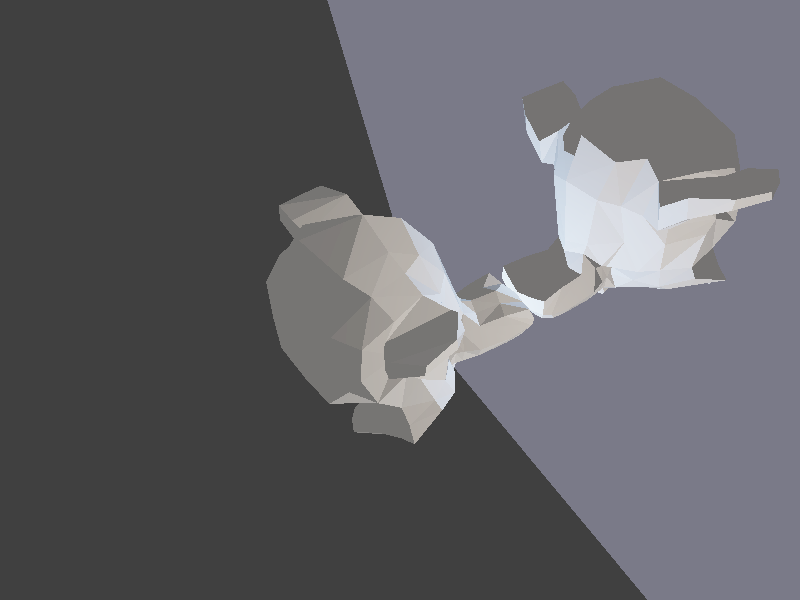

# Vulkan Compute Path Tracer

A path tracer written entirely in a Vulkan compute shader. **No hardware ray tracing** —
the BVH traversal, triangle intersection, and shading all run on general-purpose
shader cores.

Runs on an **Intel UHD 630** (Coffeelake, 2017, no RT cores, 192 shader lanes).
Renders path-traced Suzanne with real shadows, one-bounce GI, and mirror reflections
at roughly **0.3 FPS**. After ~100 frames of temporal accumulation the image is
noise-free.

---

## What it does

- **BVH traversal** — stack-based, single-leaf (linear scan over ~970 triangles;
  a real median-split builder is pending, see limitations).
- **PBR** — Cook-Torrance with metallic/roughness, three colored lights, Fresnel,
  GGX distribution, Smith geometry.
- **Shadows** — per-light shadow rays. Real occlusion, not baked.
- **Global illumination** — one-bounce indirect diffuse, 2 hemisphere samples per
  pixel per frame, cosine-weighted.
- **Mirror reflections** — secondary trace, up to 2 bounces, PBR-shaded at every hit.
- **Temporal accumulation** — 100+ frames averaged in a vec4 SSBO, so GI noise
  converges. Press R to reset.
- **OBJ loading** — Suzanne via suzanne.obj, camera auto-fit to mesh bounds.

## Architecture

Pipeline per frame:

compute dispatch -> storage image -> barrier -> blit pass -> swapchain

The compute shader reads a BVH and vertex SSBO, traces a path per pixel, accumulates
into a device-local buffer, and writes a tone-mapped average into a R8G8B8A8_UNORM
storage image. A fullscreen-triangle blit samples that image into the swapchain.

The cube-era raster path (PBR pipeline, depth attachment, real render pass) is still
in main.cpp and unused. It was the scaffold for the compute path.

## Build

Requirements: Vulkan SDK, GLFW, glm, glslc.

Compile shaders:
glslc shaders/bvh.comp  -o shaders/bvh.comp.spv
glslc shaders/blit.vert -o shaders/blit.vert.spv
glslc shaders/blit.frag -o shaders/blit.frag.spv

Build + run (adjust to your Makefile / CMake target):
make test

You will need suzanne.obj next to the binary. It is not committed (see .gitignore).

## Controls

R - Reset temporal accumulation

## Known limitations

- **BVH is single-leaf.** Every ray does a linear scan over all triangles. Correct,
  but O(n) per ray. A median-split builder exists in a git tag but has an unresolved
  bug and is not enabled.
- **Glass / refraction** has a correctness bug on thin high-curvature geometry
  (Suzanne's ears, fingers) — rays trap inside the mesh and drain throughput to
  near-zero. Deferred until the BVH is fixed; the single-leaf AABB cannot prune
  adjacent-triangle noise.
- **Noise.** 2 GI samples per pixel per frame means the first ~30 frames are noisy.
  The image converges over ~100 frames if the camera is static.
- **No denoiser.** Purely sample-count based.
- **Suzanne is flat-shaded** (geometric normals). Barycentric vertex-normal
  interpolation is a pending change.

## Why

Wanted to prove that path tracing is an algorithm, not a hardware feature.

No RT cores. No vendor extensions. Just a compute shader doing floating-point math
on a general-purpose GPU. The renderer takes longer to converge than it would on
an RTX card, but it is running the same algorithm.

## Reference

- Ray Tracing in One Weekend - algorithm reference
- Physically Based Rendering - PBR math
- Khronos Vulkan Tutorial - the scaffold this grew from
